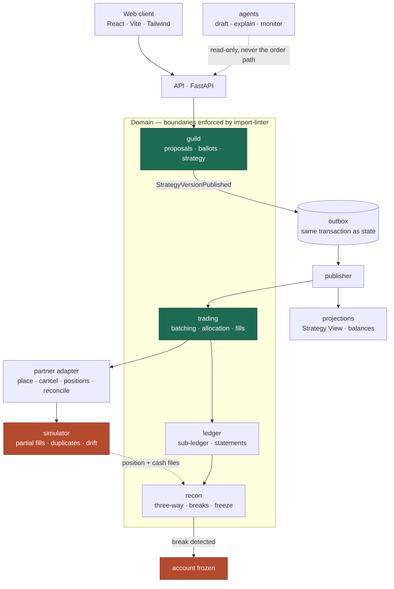

# Guild

**A group decides. Every member's own account acts.**

Guild is a social investing platform for small groups of verified friends. A Guild
votes once on a change to its shared strategy, and that decision executes as
separate orders in each member's own brokerage account. Nothing is ever pooled.

> **This repository is a proof of concept.** Partners are simulated, no real money
> moves, no accounts are opened, and nothing here is an offer of any financial
> product or service.

---

## Why this is interesting

Every social feature in retail finance is a feed, a leaderboard, or one-to-one copy
trading bolted onto a single-player product. The reason is structural rather than
technical: a shared pot of money is a fund, and a fund has to be registered. So the
industry built *broadcast* and left the *decision* alone.

Guild's mechanic — **vote once, execute N times** — keeps the group decision while
leaving every dollar in its owner's account. That shifts the hard problems to
engineering:

1. One decision fans out to 50 accounts, each sized, netted and consented separately.
2. Everyone in a batch receives the same average price, by construction.
3. Replay, duplicate callbacks, partial fills and ambiguous timeouts never produce a
   duplicate order.
4. Our ledger is a projection of records we do not own, so it must reconcile
   continuously against them.

Those four are what this repository exists to demonstrate.

## What is here

| Path | Contents |
| --- | --- |
| `docs/` | Architecture, domain model, UI specification, implementation plan, ADRs |
| `backend/` | Python modular monolith: domain, adapters, API, agents |
| `frontend/` | TypeScript + React + Vite + Tailwind client |
| `design/screens/` | Static mockups of the member-facing screens |

## Architecture

A modular monolith with one package per bounded context and import boundaries
enforced in CI, so services can be extracted later without a rewrite. Aggregate
state and its outbox are written in a single transaction; a publisher drains the
outbox. Every partner — clearing, banking — sits behind a four-method adapter
(`place`, `cancel`, `positions`, `reconcile`), which is why a simulator is a drop-in
replacement for a real integration. Agents draft, explain and monitor; they are never
on the critical order path, which is deterministic code.



### One decision, every member's own account

```mermaid
sequenceDiagram
    participant M as Members
    participant P as Proposal
    participant S as GuildStrategy
    participant RB as MemberRebalance
    participant B as OrderBatch
    participant X as Partner

    M->>P: cast ballots
    P->>P: decide under rules frozen at submission
    P->>S: compare-and-set on base version
    S-->>RB: fan out, one per member, independent
    RB->>RB: eligibility, limits, sizing, netting
    RB-->>M: consent card
    M->>B: approve, collected into a batching window
    B->>B: seal allocation statement BEFORE submission
    B->>X: one block order, idempotency key
    X-->>B: fills at several prices
    B->>B: volume-weighted average, allocated pro-rata
    Note over B,X: every account books the same price;<br/>rounding residual sits with the firm
```

Full detail in [`docs/architecture.md`](docs/architecture.md) and
[`docs/domain-model.md`](docs/domain-model.md).

## The simulator is the demo

The partner simulator is deliberately hostile, driven by configuration:

```yaml
partial_fills: true          # fill 2,600 of 4,000 shares
latency_p99_ms: 8000
duplicate_webhooks: 0.05
out_of_order_fills: true
ambiguous_timeouts: true     # order placed, response lost
position_drift: 0.001        # triggers a reconciliation break
```

Turn the dials up and the invariants above should still hold. If they do not, that is
a bug worth a issue.

## Getting started

```bash
docker compose up -d          # postgres
cd backend && pip install -e ".[dev]"
pytest                         # invariant and chaos suites
uvicorn guild.api.main:app --reload
cd ../frontend && npm install && npm run dev
```

## Status

Early. The shared value types, the partner protocol and the simulator skeleton are
real; the aggregates and projections are being filled in milestone by milestone.
See [`docs/implementation-plan.md`](docs/implementation-plan.md) for the build order
and what "done" means.

## Licence

MIT. See [`LICENSE`](LICENSE).
